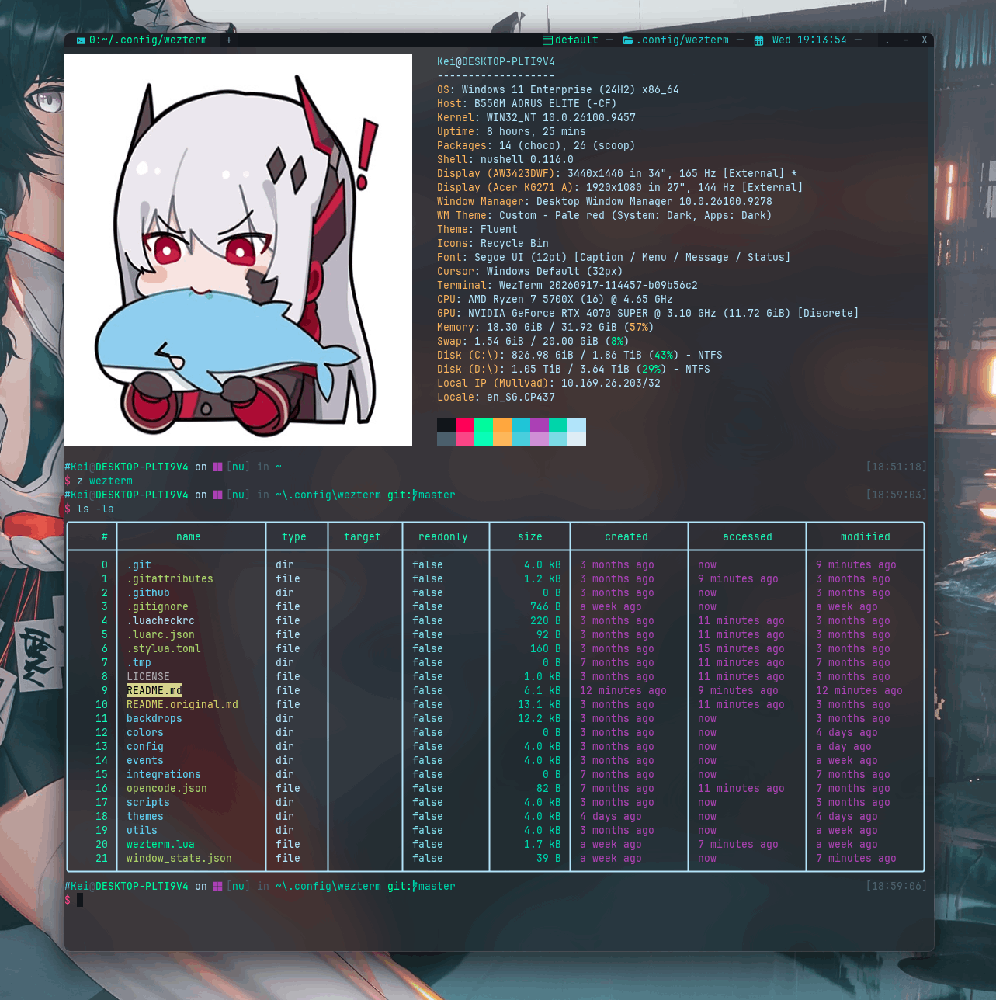

<h2 align="center">My WezTerm Config</h2>

<p align="center">
  
</p>

This WezTerm config targets the nightly build. It uses a feature-toggle architecture (`Features.register` and the JSON-backed `user.json`). The config is in `config/`, the events are in `events/`, and the utilities are in `utils/`.

<p align="center">
  
</p>

---

## What's in this config

### Feature toggle system

You register a feature in `config/features.lua`. Each feature has a name, a description, optional dependencies, and a default state. The state of each feature is in `config/user.json`. WezTerm loads this file before the rest of the config runs.

You can change a feature in two ways:

- **F2** → command palette → "Toggle Feature". This selection writes to `user.json` and reloads the config, so the change applies immediately.
- **Edit `config/user.json` directly.** The file is safe to edit by hand. WezTerm watches it for config reload.

Dependencies resolve at read time (`Features.is_enabled`), not at toggle time. If a parent feature is off, the child shows as off even when its own flag is on.

The available features and their default states:

**UI**
| Feature | Default | Notes |
|---|---|---|
| `left-status` | on | Key table indicator |
| `right-status` | on | Workspace, cwd, battery, date |
| `workspace-display` | on | Depends on `right-status` |
| `cwd-display` | on | Depends on `right-status`. Uses `find_git_dir` |
| `battery-display` | on | Depends on `right-status` |
| `date-display` | on | Depends on `right-status` |
| `tab-bar` | on | |
| `new-tab-button` | on | |
| `gui-startup` | on | Maximize on startup (unless `window-state` is on) |

**Visual**
| Feature | Default | Notes |
|---|---|---|
| `backdrops` | on | Random image cycle from `backdrops/` |
| `background-blur` | on | Platform-specific blur. Depends on `backdrops` |
| `animations` | on | |
| `cursor-blink` | on | Depends on `animations` |
| `visual-bell` | on | |
| `scroll-bar` | on | |

**Functionality**
| Feature | Default | Notes |
|---|---|---|
| `scrollback` | on | 20000 lines default |
| `hyperlinks` | on | Clickable URLs (`wezterm.default_hyperlink_rules()` + `{url}` braces) |
| `command-palette` | on | F2 |
| `auto-reload` | on | Config reloads on file change |
| `exit-confirmation` | on | `AlwaysPrompt` |

**Tabs**
| Feature | Default | Notes |
|---|---|---|
| `tab-index` | off | |
| `tab-title` | on | Process icons, CJK-safe truncation, unseen-output indicators |
| `last-active-tab` | on | |
| `window-state` | off | Save and restore the window size (WezTerm has no window position API) |


---

## `config/user.json`

```json
{
  "features": {
    "workspace-display": false,
    "battery-display": false,
    "animations": false,
    "tab-bar": true,
    "backdrops": true,
    "right-status": true
  },
  "custom": {
    "scrollback_lines": 20000,
    "date_format": "%a %H:%M:%S",
    "cwd_use_git_root": true,
    "hide_active_tab_unseen": true,
    "unseen_icon": "circle"
  }
}
```

The config reads both `features` and `custom` through `Features.get_custom_settings()`. This function merges the defaults for any missing keys. The old separate `config/user.lua` path is gone. All settings go through the feature system.

---

## Theme

Ghost in the Shell and Blade Runner inspired palettes.

Each theme is one file in `themes/`. The file holds a role table, a `wezterm` overlay, and a `config` overlay. `themes/registry.lua` lists the registered themes. The config resolves the role values through `colors/theme.lua`, and `colors/custom.lua` maps them into the WezTerm palette.

The config ships with two themes: `gits-scarlet` (default) and `gits-cyan`.

Use the F2 command palette to switch a theme. The palette offers "Theme: Select", "Theme: Next", and "Theme: Previous". Each switch writes the choice to `custom.theme` in `config/user.json` and reloads the config.

| Role | `gits-scarlet` (default) | `gits-cyan` |
|---|---|---|
| Background | `#0b0b14` | `#0a0e14` |
| Text | `#e41951` | `#b3e5fc` |
| Cyan | `#00c5c7` | `#26c6da` |
| Green | `#00dc84` | `#00ff9f` |
| Crimson | `#ff0051` | `#ff0066` |
| Hotpink | `#e41951` | `#ff3385` |
| Teal | `#00d4aa` | `#00d4aa` |

See `themes/gits-scarlet.lua` and `themes/gits-cyan.lua` for the complete role list. Do not put a hex value in the code. The theme file is the one source for each colour.

---

## Installation

**Requirements:**
- WezTerm nightly (or `20240127`+)
- JetBrainsMono Nerd Font (or any Nerd Font)

```sh
git clone https://github.com/Nirvaxstiel/wezterm-ghost-in-the-shell.git ~/.config/wezterm
```

**Platform installers:**
- Windows: `scoop install wezterm` / `winget install wez.wezterm` / `choco install wezterm`
- macOS: `brew install --cask wezterm`
- Linux: [wezfurlong.org/wezterm/install/linux.html](https://wezfurlong.org/wezterm/install/linux.html)

**Font:**
- macOS: `brew tap homebrew/cask-fonts && brew install font-jetbrains-mono-nerd-font`
- Windows: `scoop bucket add nerd-fonts && scoop install JetBrainsMono-NF`

### First-time tweaks

- Edit `config/domains.lua` for the SSH and WSL domain definitions.
- Edit `config/launch.lua` for the shell path on each platform.

### Known issues

**Git Bash on Windows.** If Git Bash stops with exit code 1, make sure that the path in `config/launch.lua` is correct. Common paths:
- `C:\Program Files\Git\bin\bash.exe`
- `C:\Program Files\Git\usr\bin\bash.exe`
- `C:\Program Files\Git\cmd\bash.exe`

A Scoop Git install can need a wrapper:
```lua
args = {
    'cmd.exe', '/c',
    'set MSYS=pathtype=unix&& C:\\Users\\kevin\\scoop\\apps\\git\\current\\bin\\bash.exe -l'
},
```

**Nushell on Windows.** Disable OSC 133 to prevent unwanted scrolling:
```nu
$env.config.shell_integration.osc133 = false
```
---

## Credits

- Original: [KevinSilvester/wezterm-config](https://github.com/KevinSilvester/wezterm-config)
- Theme: Ghost in the Shell / Blade Runner (Wallace Corporation)
